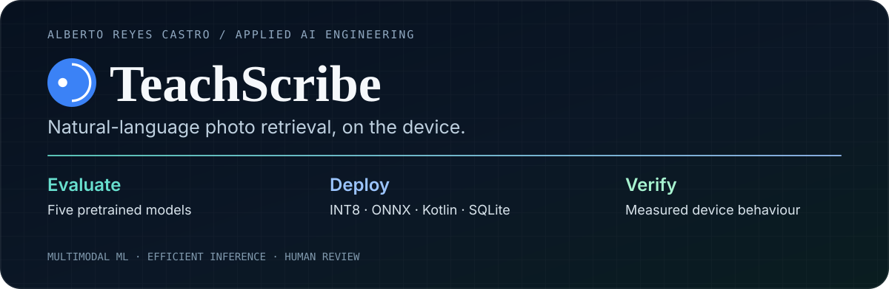
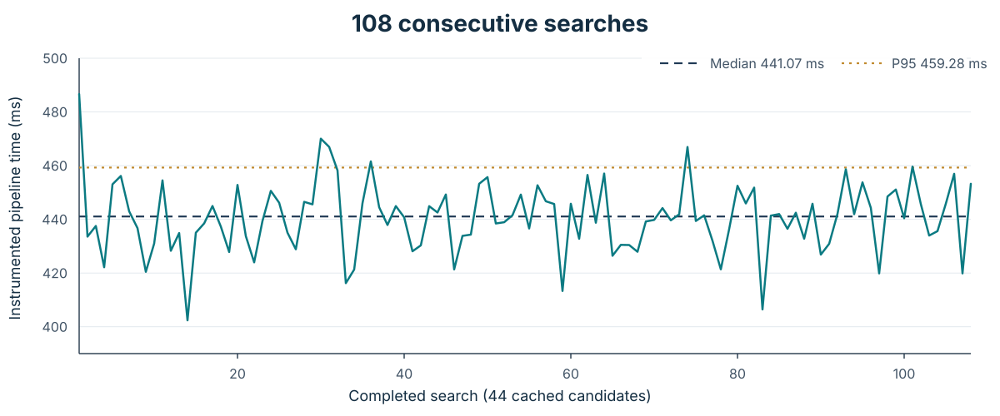
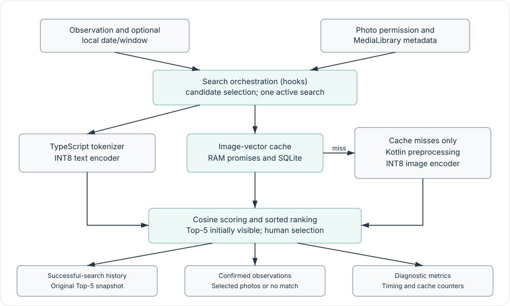

<p align="center"></p>

# TeachScribe — On-Device Multimodal Photo Retrieval

**Applied AI engineering case study · Alberto Reyes Castro**

<p align="center"><strong>Production pipeline · Shipped within TeachScribe's 50+ UK-school deployment · DfE AI Tools for Education programme</strong></p>

[Engineering report (PDF)](docs/TeachScribe_On_Device_Multimodal_Retrieval_Public_Engineering_Case_Study.pdf) · [Architecture](docs/ARCHITECTURE.md) · [Validation](docs/VALIDATION.md) · [Evidence](evidence/data/README.md)

> **Full proprietary engineering repository available to hiring teams on request, with TeachScribe's permission.** It contains the implementation, tests, validation tooling and delivery evidence described in this public case study. The source is not published here because TeachScribe owns the product code.

This public repository keeps the system design, measured results, validation outcomes and de-identified evidence while withholding reusable product implementation.

## Technical deep dive

https://github.com/user-attachments/assets/686275ae-5e92-4469-83d3-fb213f77ac7a

**98-second narrated walkthrough** — on-device multimodal retrieval, model selection, INT8 deployment, Android optimisation, measured performance and validation.

*Narration was generated in ElevenLabs using my own voice clone. AI tools were also used as pair-programming/editing assistance in the post-delivery portfolio work; technical claims remain grounded in the audited engineering evidence.*

## Problem

Early Years observations can be associated with many photos captured around the same period. The feature uses the observation text plus an optional local date/window filter to rank relevant photos directly on the Android tablet, then leaves the final choice to the teacher.

The retrieval path is fully local: text and images are encoded on-device, image embeddings are reused from a persistent cache, and the ranked Top-5 remains a human-reviewed suggestion rather than an automated decision.

## Production context

The pipeline has been integrated into TeachScribe and shipped within its deployment to **50+ UK schools**. That number is deployment reach, not measured adoption of this specific feature. The quantitative results below come from controlled engineering evaluation rather than production telemetry.

The deployed snapshot predates a small set of **post-delivery fail-closed guards** added during the audited portfolio review. Those guards reject non-finite or wrong-dimension embeddings before they can reach caching/ranking; valid finite 512-dimensional embeddings follow the previous path unchanged. Historical latency, memory, thermal and energy results remain attributed to the benchmark build rather than the later refactor.

## Engineering contribution

- compared **5 pretrained vision-language models** and selected TinyCLIP 39M/16;
- deployed separate INT8 text/image ONNX encoders on constrained Android hardware;
- implemented native Android image preprocessing and persistent RAM + SQLite embedding reuse;
- measured scheduling, preprocessing, memory, startup, thermal and battery-side behaviour;
- tuned scheduling and preprocessing, and retained lazy image-model loading from measured memory results;
- preserved explicit human review and independent search-history records;
- validated the later refactor with **33 Node tests**, **15 Python tests**, a **143-unit / 0-mismatch** mechanical refactor proof and an on-device A/B comparison.

## Results

Measured on one Huawei MediaPad M3 Lite 8 (CPN-W09), Android 7 / ARM64, unless otherwise stated.

| Result | Scope |
| :-- | :-- |
| **441.07 ms median / 459.28 ms P95** | 108 consecutive cached searches over 44 photos |
| **1.82% drift** | first 20 vs last 20 medians in that sequence |
| **≈0.5 mWh/search** | whole-device, idle-subtracted estimate during the sustained run |
| **74.77% smaller text encoder** | 178,520,196 → 45,042,123 bytes after INT8 quantisation |
| **97/110 same top-1 image** | shipped INT8 vs FP32; descriptive total across three related sets |
| **76.3 MiB idle PSS** | lazy image session; 166.6 MiB preload variant rejected |
| **17/20 Hit@1** | TinyCLIP 39M/16 on the curated Hard set; 95% Wilson CI 64–95% |



## Engineering decisions

| Decision | Evidence / trade-off |
| :-- | :-- |
| **TinyCLIP 39M/16 over MobileCLIP-S0** | higher Hit@1 on all three compared sets; paired differences did not establish broad statistical separation, so licensing and deployment path also mattered |
| **INT8 deployment** | text encoder bytes fell 74.77%; matched retrieval testing found no significant FP32/INT8 difference on any individual set |
| **Persistent image cache** | fully cached searches can avoid image-model inference and pay only for text encoding, cache access, scoring/sorting and scheduling |
| **Fix decoding before inference** | later preprocessing observations were ~0.37–0.50 s versus an earlier ~2.2 s reference; different images, so not presented as a paired speedup |
| **Yield every 20 candidates** | 531 → 379 ms in the measured 37-candidate scheduling experiment; the faster ~304 ms policy was rejected after responsiveness concerns |
| **Keep image inference lazy** | proactive preloading increased idle PSS from 76.3 to 166.6 MiB |
| **Separate ranking from decisions** | successful-search history preserves the original Top-5; the teacher's later selected-photo/no-match decision is stored independently |

## Architecture



The architecture uses separate text and image encoders, native Android preprocessing, persistent image-vector reuse, cosine ranking and explicit human review. The public architecture retains tensor contracts, cache lifecycle, persistence behaviour, timing boundaries and trade-offs while omitting source-file maps and implementation bodies. See [Architecture](docs/ARCHITECTURE.md).

## Evidence you can verify

The repository publishes the underlying aggregate/de-identified data rather than only screenshots or headline claims: model selection, Wilson intervals, exact McNemar comparisons, INT8-vs-FP32 retrieval, all 108 sustained timings, warm/startup references, temporal cases and scoped engineering measurements.

Run the independent public verifier with standard-library Python:

```bash
python evidence/verify_stats.py
```

It recomputes the headline latency statistics, drift, model-size reduction, Wilson intervals and exact McNemar values directly from the committed CSV/JSON evidence. This script is portfolio verification tooling, **not TeachScribe application source code**.

See [Evidence data](evidence/data/README.md), [Validation](docs/VALIDATION.md), [Limitations](docs/LIMITATIONS.md), [Privacy](docs/PRIVACY.md) and the [Publication boundary](docs/PUBLICATION_BOUNDARY.md).

## Evidence limits

One older Android tablet and small curated retrieval sets do not establish a modern-device matrix, large-gallery scalability or population accuracy. Cached-search timing excludes final rendering and record persistence. Cosine similarity is not a probability, and this retrieval path does not identify people or infer learning outcomes. Historical performance results were not silently reassigned to the later refactored build.

## Public / private boundary

This case study keeps the real architecture, aggregate measurements, model-selection evidence, de-identified acceptance cases and validation outcomes. It intentionally omits reusable product implementation: React Native/TypeScript application source, Kotlin native-module source, implementation tests/build scripts, model binaries, APKs, classroom imagery, real media identifiers and internal delivery correspondence.

For a hiring process, the **full private engineering repository can be shared on request with TeachScribe's permission** for source-level review.

## Rights and AI assistance

TeachScribe Ltd owns the proprietary application code described by this case study. This repository is not an open-source release; see [LICENSE](LICENSE), [Rights and attribution notice](NOTICE.md) and [Third-party notices](THIRD_PARTY_NOTICES.md).

I designed, built, measured and delivered the retrieval prototype. Post-delivery portfolio refactoring, testing/documentation and publication work used AI pair-programming/editing assistance; the public evidence and private engineering repository provide the audit trail for the technical claims.

---

**Alberto Reyes Castro · Applied AI Engineer · London, UK**  
[Portfolio](https://albertoreyescastro.github.io) · [GitHub](https://github.com/albertoreyescastro) · [LinkedIn](https://www.linkedin.com/in/alberto-reyes-ba5546238)
